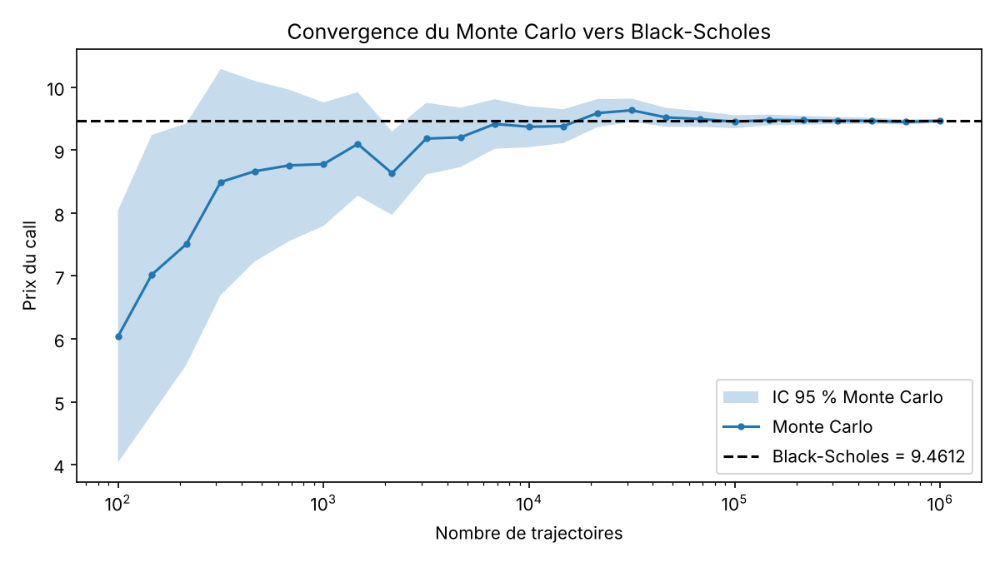
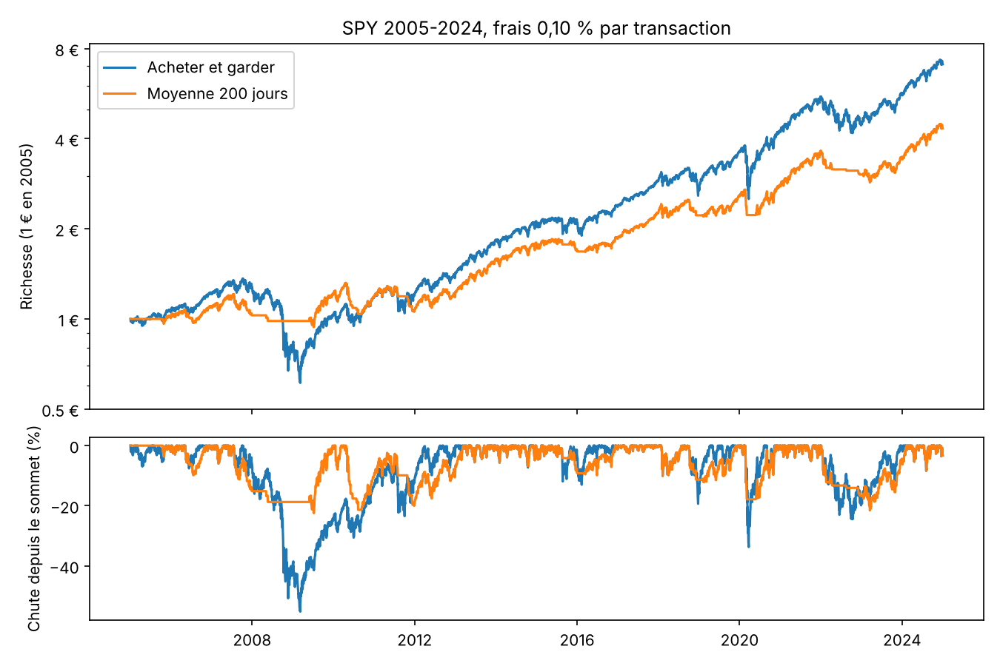
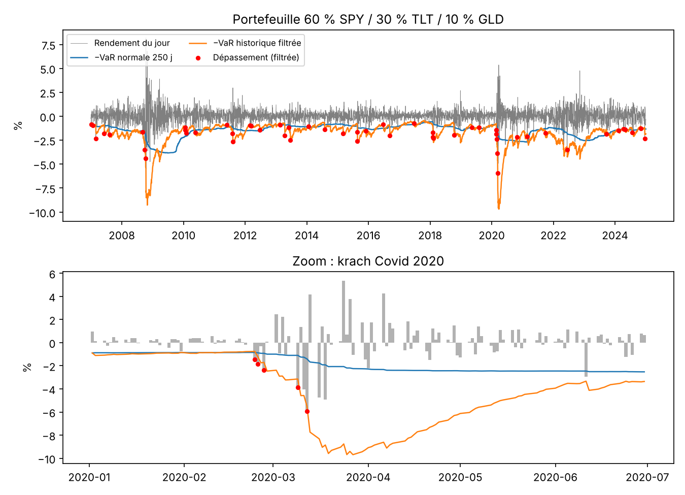
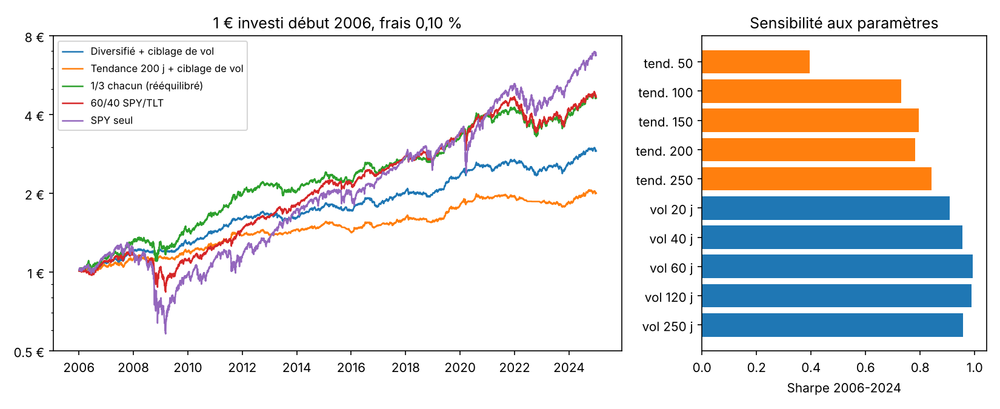

<div align="center">

# 📊 Projets de finance quantitative

**Quatre projets en Python, construits pas à pas, testés et documentés.**

Fil conducteur : *ne jamais croire un résultat sans l'avoir vérifié.*


</div>

---

## Les projets

| | Projet | Ce qu'il montre | Résultat clé | Tests |
|---|---|---|---|---|
| 1 | [**Pricer d'options**](option-pricer/) | Black-Scholes, grecques, volatilité implicite, Monte Carlo, options asiatiques | Variance du Monte Carlo divisée par **24** (européenne) et par **650** (asiatique) | 40 |
| 2 | [**Moteur de backtest**](backtester/) | Backtest sans biais d'anticipation, frais, Sharpe, drawdown | Oublier le décalage d'un jour transforme ×4,9 en **×34,7** | 14 |
| 3 | [**Modèle de risque**](risk-model/) | VaR et Expected Shortfall par 4 méthodes, tests de Kupiec et Christoffersen, feux de Bâle | La loi normale sous-estime l'ES de **35 %** ; 60 % d'actions = **92 %** du risque | 19 |
| 4 | [**Stratégie robuste**](strategy/) | Walk-forward, plateau de paramètres, bootstrap, Deflated Sharpe Ratio | La tendance ne résiste pas aux tests ; la diversification avec ciblage de volatilité, si | 11 |

---

### 1. Pricer d'options : Black-Scholes et Monte Carlo



Prix exact par la formule de Black-Scholes, puis par simulation. Le Monte Carlo converge vers le prix exact en $1/\sqrt{N}$ ; les variables antithétiques et la variable de contrôle divisent sa variance par 24 à coût égal. Pour l'option asiatique, qui n'a pas de formule, l'asiatique géométrique sert de variable de contrôle. → [Détails](option-pricer/)

### 2. Moteur de backtest



20 ans de S&P 500. La moyenne mobile 200 jours rapporte moins que le marché (7,6 % contre 10,3 % par an), mais limite la pire chute à −22 % contre −55 %. Sur 499 paramétrages, le meilleur sur 2006-2014 ne prédit rien sur 2015-2024 : c'est le surapprentissage. → [Détails](backtester/)

### 3. Modèle de risque : VaR et Expected Shortfall



Portefeuille actions, obligations et or. Sur 18 ans, la VaR normale est dépassée 2,2 fois plus souvent que promis. Seule la simulation historique filtrée passe le test de Kupiec et ne passe jamais en zone rouge de Bâle. → [Détails](risk-model/)

### 4. Stratégie multi-actifs robuste



Tendance, ciblage de volatilité et diversification, démontés ingrédient par ingrédient. Le filtre de tendance est fragile (Sharpe de 0,39 à 0,84 selon la fenêtre) ; la diversification avec ciblage de volatilité forme un plateau (0,91 à 0,99), avec un Deflated Sharpe de 99,9 %. Son avance sur un simple portefeuille équipondéré n'est cependant pas statistiquement prouvée. → [Détails](strategy/)

---

## Lancer les projets

```bash
git clone https://github.com/simonkirch21/quant-projects.git
cd quant-projects
pip install numpy scipy pandas matplotlib yfinance pytest

cd option-pricer && python -m pytest && python scripts/demo.py
```

Même chose dans chaque dossier : `python -m pytest` lance les tests, `python scripts/demo.py` régénère les figures et les tableaux du README.

Données : prix ajustés quotidiens de SPY, TLT et GLD de 2005 à 2024 (Yahoo Finance), enregistrés dans `backtester/data/` pour des résultats reproductibles.

<div align="center">
<sub>Projets réalisés pendant un Master 1 Finance · Voir aussi <a href="https://github.com/simonkirch21/analyse-actions">Analyse Actions</a>, application d'analyse boursière</sub>
</div>
