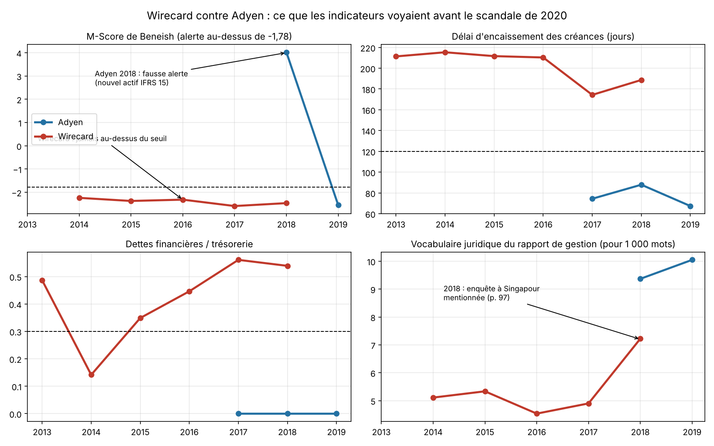
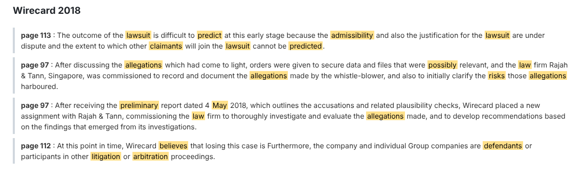

# Signaux d'alerte comptables : le cas Wirecard

Repérer les signaux d'alerte comptables d'une société, comme le ferait un vendeur à découvert ou un analyste crédit, en croisant des ratios quantitatifs et l'analyse du texte du rapport de gestion. Cas test : **Wirecard**, qui s'est effondrée en juin 2020 après avoir reconnu que 1,9 milliard d'euros de trésorerie « n'existait probablement pas », comparée à un pair sain, **Adyen**. Le projet est vérifié par 24 tests.



## Résultat principal

**Les scores classiques ne détectent pas Wirecard. Des signaux plus spécifiques, si.**

- Le **M-Score de Beneish** reste sous le seuil d'alerte (−1,78) chaque année de 2014 à 2018. Le **Z'' d'Altman** classe Wirecard en zone saine, et son flux de trésorerie d'exploitation dépasse le bénéfice. C'est logique : la fraude portait sur une **trésorerie fictive**, si bien que les flux de trésorerie étaient eux-mêmes faux. Les scores fondés sur l'écart entre bénéfice et trésorerie ne pouvaient pas la voir.
- À l'inverse, **Adyen déclenche une fausse alerte** en 2018 (M-Score +4,0). Elle vient de l'indice AQI (16,8), après l'apparition d'un nouvel actif comptable lié à la norme IFRS 15 (140 M€ d'actifs sur contrat).
- Ce qui distinguait vraiment Wirecard :
  - **délai d'encaissement des créances** de 174 à 215 jours, contre 67 à 88 jours pour Adyen, pourtant au même métier ;
  - **endettement croissant malgré une trésorerie abondante** : la dette passe de 14 % à 56 % de la trésorerie déclarée (« si l'argent existe, pourquoi emprunter ? »), quand Adyen n'a aucune dette ;
  - **en 2018, des créances qui croissent plus vite que le chiffre d'affaires** (+47 % contre +35 %) ;
  - **dans le rapport 2018, le vocabulaire juridique bondit de 47 %**. Parmi les phrases nouvelles, l'outil fait remonter, page 97, l'enquête sur un **lanceur d'alerte dans le service comptable de Singapour**, confiée au cabinet Rajah & Tann. C'était écrit dans le rapport annuel, un an avant l'effondrement.



## Méthode

### Volet quantitatif (sans IA)

| Indicateur | Formule | Lecture | Source |
|---|---|---|---|
| **M-Score de Beneish** | −4,84 + 0,920 DSRI + 0,528 GMI + 0,404 AQI + 0,892 SGI + 0,115 DEPI − 0,172 SGAI + 4,679 TATA − 0,327 LVGI | > −1,78 : profil de manipulateur | Beneish (1999) |
| **Z'' d'Altman** | 6,56 X₁ + 3,26 X₂ + 6,72 X₃ + 1,05 X₄ (fonds de roulement, réserves, EBIT / actif ; capitaux propres / dettes) | < 1,10 détresse ; > 2,60 saine | Altman (1995) |
| Z d'origine | 1,2 X₁ + 1,4 X₂ + 3,3 X₃ + 0,6 X₄ + 1,0 X₅ (capitalisation boursière) | < 1,81 détresse ; > 2,99 saine | Altman (1968) |
| **Accruals de Sloan** | (résultat net − flux d'exploitation) / actif moyen | élevé : bénéfice peu encaissé | Sloan (1996) |
| Conversion en trésorerie | flux d'exploitation / résultat net | < 1 durablement : alerte | |
| **DSO** | créances / chiffre d'affaires × 365 | jours pour encaisser | |
| Dette / trésorerie | dettes financières / trésorerie | dette et trésorerie élevées en même temps : alerte | |

Les 8 variables du M-Score : DSRI (créances / CA), GMI (marge brute), AQI (actifs « mous »), SGI (croissance), DEPI (amortissement), SGAI (frais généraux), LVGI (levier), TATA (accruals). Wirecard et Adyen étant des sociétés de services, le **Z''** est la version adaptée ; le Z d'origine est calculé pour comparaison.

**Données** : 9 années-sociétés saisies à la main depuis les rapports annuels publiés (Wirecard 2013-2018, Adyen 2017-2019), avec **le numéro de page de chaque chiffre** dans `data/financials.csv`. Les chiffres 2018 de Wirecard ont été relus sur les pages affichées en image, car la police du PDF ne permet pas d'extraire les chiffres. Contrôle automatique : actif = passif + capitaux propres pour chaque année. Le guide des postes est dans [`data/GUIDE_POSTES.md`](data/GUIDE_POSTES.md), avec un modèle vide (`data/template.csv`) pour analyser une autre société.

### Volet textuel

1. **Extraction** du rapport de gestion (pdfplumber). Les pages à deux colonnes sont détectées (gouttière verticale) et lues colonne par colonne, sinon les phrases s'entremêlent.
2. **Dictionnaire de Loughran-McDonald** (version 1993-2025) : mots négatifs, positifs, incertains, juridiques et modaux, pour 1 000 mots ; ton net ; **indice de Fog** (lisibilité).
3. **Phrases nouvelles** : une phrase est retenue si moins de 30 % de ses suites de 5 mots figuraient dans le rapport de l'année précédente, puis classée par nombre de mots juridiques ou incertains. Le texte repris chaque année n'apprend rien ; ce qui change, si.
4. **Mode Claude** (facultatif, `--llm`) : chaque paquet de 8 pages est envoyé à l'API Claude (`claude-opus-5-5`), qui renvoie un JSON contraint par un schéma : type de signal, **citation exacte**, page, gravité de 1 à 5, explication. **Chaque citation est ensuite recherchée dans le texte source** : une citation introuvable est rejetée (anti-hallucination), une page erronée est corrigée. Les réponses sont mises en cache pour ne pas payer deux fois le même appel.

| Rapport de gestion | Mots | Négatif | Positif | Incertain | Juridique | Ton net | Fog |
|---|---|---|---|---|---|---|---|
| Wirecard 2014 | 28 380 | 10,3 | 11,2 | 17,6 | 5,1 | +0,04 | 22,2 |
| Wirecard 2015 | 32 247 | 10,2 | 11,9 | 16,9 | 5,3 | +0,07 | 22,0 |
| Wirecard 2016 | 35 951 | 9,5 | 12,3 | 16,8 | 4,5 | +0,13 | 21,7 |
| Wirecard 2017 | 46 944 | 8,3 | 13,7 | 14,1 | 4,9 | +0,25 | 21,9 |
| **Wirecard 2018** | 38 085 | 12,6 | 11,1 | 16,6 | **7,2** | **−0,06** | 22,0 |
| Adyen 2018 | 13 771 | 14,5 | 12,2 | 20,6 | 9,4 | −0,09 | 21,5 |
| Adyen 2019 | 11 346 | 19,6 | 17,5 | 23,8 | 10,0 | −0,05 | 20,8 |

Le ton de Wirecard devient de plus en plus positif jusqu'en 2017, puis se retourne en 2018 (rapport publié en avril 2019, après les premiers articles du *Financial Times*). Adyen a un vocabulaire plus négatif et plus juridique **par construction** : son rapport inclut une longue section de facteurs de risque. Les niveaux ne se comparent donc pas d'une société à l'autre ; ce sont les **variations dans le temps** qui comptent.

### Score composite

Chaque signal vaut 1 s'il est allumé. Le score est la part des signaux allumés parmi ceux calculables cette année-là.

| Signal | Seuil |
|---|---|
| M-Score | > −1,78 |
| Z'' | ≤ 2,60 |
| Accruals de Sloan | > 5 % de l'actif |
| Conversion en trésorerie | < 80 % |
| DSO | > 120 jours |
| Créances contre CA | croissance des créances > croissance du CA + 10 points |
| Dette malgré la trésorerie | dette / trésorerie > 30 % et trésorerie > 20 % de l'actif |
| Vocabulaire juridique | hausse > 25 % sur un an |
| Lisibilité | Fog en hausse de plus de 1,5 point |
| Mode Claude | au moins un signal vérifié de gravité ≥ 4 |

| | 2013 | 2014 | 2015 | 2016 | 2017 | 2018 | 2019 |
|---|---|---|---|---|---|---|---|
| **Wirecard** | 2 / 4 | 1 / 7 | 2 / 9 | 2 / 9 | 2 / 9 | **4 / 9** | |
| Adyen | | | | | 0 / 4 | 2 / 7 | 0 / 9 |

Pour Wirecard, les signaux allumés chaque année sont le DSO et la dette malgré la trésorerie ; 2018 ajoute les créances et le vocabulaire juridique. Pour Adyen 2018, les deux alertes (M-Score, créances) viennent de la très forte croissance de l'année et du changement de norme : ce sont des **faux positifs**.

## Ce que vérifient les tests (24)

- **Formules sur des valeurs calculées à la main** : les 8 variables et le M-Score (−1,3799 sur l'exemple, −2,48 pour une entreprise stable), le Z et le Z'', les accruals, le DSO, la dette / trésorerie.
- **Données réelles** : le bilan s'équilibre chaque année, chaque ligne est sourcée, un bilan déséquilibré est détecté ; le M-Score de Wirecard reste sous le seuil ; la fausse alerte d'Adyen vient bien de l'AQI.
- **Texte** : recollage des lignes, découpage en phrases, comptage par catégorie et indice de Fog calculés à la main.
- **Anti-hallucination** : une citation inventée est rejetée, une page erronée est corrigée, la tolérance porte seulement sur la casse, les espaces et les guillemets.
- **Mode Claude** sans appel réseau (client simulé) : le JSON est vérifié, le cache évite un second appel, un refus renvoie une liste vide.
- **Ligne de commande** : fonctionne sans PDF, sans dictionnaire et sans clé API.

## Lancer le projet

```bash
pip install -r requirements.txt
python scripts/download_data.py                 # rapports annuels (PDF) + dictionnaire Loughran-McDonald
PYTHONPATH=src python -m pytest                 # 24 tests
PYTHONPATH=src python -m redflags analyze       # indicateurs, score, rapport HTML dans outputs/
PYTHONPATH=src python -m redflags analyze --llm # + mode Claude (ANTHROPIC_API_KEY requise)
```

Ou bien `pip install -e .`, puis `python -m redflags analyze --financials data/financials.csv --reports data/reports/`.

Sorties dans `outputs/` : `report.html` (un seul fichier, graphiques Plotly interactifs, citations surlignées), `indicators.csv`, `signals.csv`, `text_scores.csv` et, en mode Claude, `llm_red_flags.csv`. La clé API ne se met jamais dans le code : variable d'environnement, voir `.env.example`.

Les rapports annuels et le dictionnaire ne sont **pas** dans le dépôt : droits d'auteur des rapports, et licence du dictionnaire réservée à un usage de recherche non commercial. `scripts/download_data.py` les télécharge depuis leurs sources officielles.

## Limites

- **Biais rétrospectif.** On sait que Wirecard a fraudé. Les seuils qui ne viennent pas de la littérature (DSO > 120 jours, dette / trésorerie > 30 %) ont été fixés en le sachant, et le choix d'Adyen comme pair aussi. Un test honnête demanderait d'appliquer les mêmes règles, sans les retoucher, à des centaines de sociétés et de compter les faux positifs.
- **Faux positifs.** Adyen 2018 en donne deux. Une croissance très rapide ou un changement de norme comptable suffisent à allumer le M-Score.
- **Le M-Score est calibré sur des entreprises industrielles américaines** (1982-1992), et pas pour des établissements de paiement disposant d'une banque. Ses coefficients ne s'appliquent qu'approximativement à Wirecard.
- **Une fraude sur la trésorerie elle-même échappe aux indicateurs comptables.** Seule une vérification externe (confirmation des soldes bancaires par l'auditeur) pouvait la prouver : c'est ce qui a fini par arriver en 2020.
- **Définitions qui changent.** Wirecard a modifié la présentation de son flux d'exploitation en 2016 (2015 publié : 178 M€ ; retraité l'année suivante : 358 M€). Chaque année est prise telle que publiée à l'époque.
- **Peu de données.** 2 sociétés, 9 années ; pas de rapport 2019 pour Wirecard, qui ne l'a jamais publié.
- **Analyse de texte** : un dictionnaire ne comprend pas le contexte (« may » le mois et « may » le verbe sont confondus). Le mode Claude n'a pas été exécuté pour ce README, faute de clé API ; il est entièrement testé avec un client simulé.

## Références

- Altman, E. (1968). Financial Ratios, Discriminant Analysis and the Prediction of Corporate Bankruptcy. *Journal of Finance*, 23(4).
- Altman, E. (2000). Predicting Financial Distress of Companies: Revisiting the Z-Score and ZETA Models. NYU Stern.
- Beneish, M. (1999). The Detection of Earnings Manipulation. *Financial Analysts Journal*, 55(5).
- Li, F. (2008). Annual report readability, current earnings, and earnings persistence. *Journal of Accounting and Economics*, 45(2-3).
- Loughran, T. et McDonald, B. (2011). When Is a Liability Not a Liability? Textual Analysis, Dictionaries, and 10-Ks. *Journal of Finance*, 66(1).
- Sloan, R. (1996). Do Stock Prices Fully Reflect Information in Accruals and Cash Flows about Future Earnings? *The Accounting Review*, 71(3).
