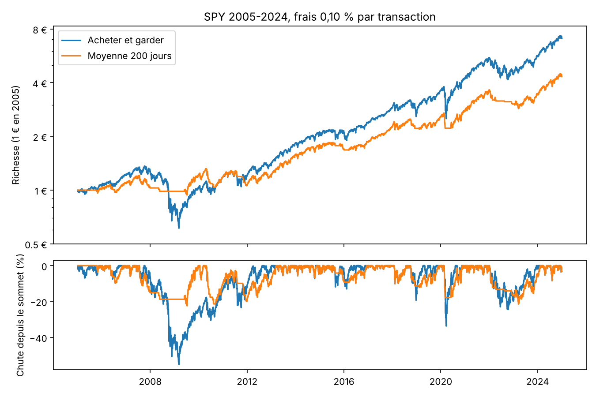

# Backtesting engine

Moteur de backtest journalier en Python. Il rejoue une stratégie sur 20 ans de prix réels (SPY, 2005-2024), en évitant le biais d'anticipation, en comptant les frais de transaction et en mesurant le risque. Il est vérifié par 14 tests.



## Structure

| Module | Rôle |
|---|---|
| `backtester/data.py` | Prix ajustés (dividendes, splits) depuis Yahoo Finance, enregistrés dans `data/` pour être reproductibles |
| `backtester/strategies.py` | Les stratégies produisent un **signal** (1 = investi, 0 = cash) à partir des prix |
| `backtester/engine.py` | Le moteur décale le signal d'un jour, applique les frais et calcule la richesse |
| `backtester/metrics.py` | Rendement annuel, volatilité, Sharpe, drawdown |
| `tests/` | 14 tests sur données simulées (sans internet) |

La stratégie ne fait que produire un signal ; c'est le moteur qui applique le décalage d'un jour. Ainsi, aucune stratégie branchée sur le moteur ne peut tricher par erreur.

## Le calcul

Pour chaque jour $t$, avec $p_t$ la position (0 ou 1), $r_t$ le rendement du SPY et $c$ le coût d'une transaction :

$$p_t = \text{signal}_{t-1}, \qquad
R_t = p_t \, r_t - c \, |p_t - p_{t-1}|, \qquad
W_t = \prod_{s \le t} (1 + R_s)$$

- **Décalage d'un jour** : le signal est calculé avec la clôture du jour $t-1$. On ne le connaît qu'à ce moment-là, donc il ne peut s'appliquer qu'au jour $t$.
- **Frais** : 0,10 % du montant échangé (courtage et écart achat/vente), payés uniquement quand la position change.
- **Hypothèses** : exécution au prix de clôture ; le cash ne rapporte rien.

## Résultats : moyenne mobile 200 jours contre acheter et garder

SPY, du 3 janvier 2005 au 31 décembre 2024, avec 0,10 % de frais par transaction.

| | Acheter et garder | Moyenne 200 jours |
|---|---|---|
| Richesse finale (1 €) | **7,09 €** | 4,34 € |
| Rendement annuel | **10,3 %** | 7,6 % |
| Volatilité | 19,0 % | **11,4 %** |
| Sharpe | 0,61 | **0,70** |
| Pire chute | −55,2 % | **−22,4 %** |
| Temps investi | 100 % | 76 % |
| Transactions | 1 | 119 |

La moyenne 200 jours gagne moins, mais avec beaucoup moins de risque. Sa pire chute est 2,5 fois plus faible, et en 2008 elle perd −4 % contre −37 % pour le marché. Elle échoue en revanche dans les baisses lentes et en dents de scie, comme en 2022, où les faux signaux s'enchaînent.

## Pièges mis en évidence

**1. Biais d'anticipation.** Sans le décalage d'un jour, la même moyenne 200 jours transforme 1 € en **34,68 €** au lieu de 4,88 € (hors frais). Le signal « le marché a monté aujourd'hui » appliqué au jour même donne **686 millions d'euros**. Un test automatique vérifie que ce biais ne peut pas réapparaître.

**2. Frais.** 119 transactions à 0,50 % au lieu de 0,10 % font tomber la richesse finale de 4,34 € à 2,69 €.

**3. Surapprentissage.** On teste 499 couples de moyennes mobiles (rapide, lente) et on garde le meilleur sur 2006-2014 :

| | Sharpe 2006-2014 | Sharpe 2015-2024 |
|---|---|---|
| Meilleure combinaison (45 j, 160 j) | **0,99** | 0,70 |
| Médiane des 499 combinaisons | 0,72 | 0,63 |
| Acheter et garder | 0,47 | **0,78** |

La corrélation entre le classement de 2006-2014 et celui de 2015-2024 est de **0,03** : être le meilleur sur le passé ne prédit rien. La « meilleure » stratégie fait ensuite moins bien que le simple achat.

**4. Biais du survivant** (non traité ici, car le SPY est un indice). Tester une stratégie sur les actions qui composent le S&P 500 *aujourd'hui* oublie celles qui ont fait faillite ou sont sorties de l'indice. Cela gonfle artificiellement les résultats.

## Ce que vérifient les tests

- Le signal est bien décalé d'un jour.
- Un signal qui « voit » le jour même ne produit rien d'extraordinaire une fois décalé (alors qu'il gagnerait des milliards sans le décalage).
- Acheter et garder = rapport des prix, moins un seul achat.
- Toujours en cash : la richesse reste exactement à 1.
- Les frais ne sont payés qu'aux changements de position (sur un prix plat, 3 transactions à 1 % donnent 0,99³).
- −50 % puis +50 % = −25 %.
- Rendement annuel, volatilité (règle de la racine du temps), Sharpe et drawdown sur des séries dont la réponse est connue.

## Lancer le projet

```bash
pip install -r requirements.txt
python -m pytest          # 14 tests
python scripts/demo.py    # figure + tableaux
```

```python
from backtester.data import load_prices
from backtester.engine import run_backtest
from backtester.metrics import summary
from backtester.strategies import sma_trend

prix = load_prices("SPY")
summary(run_backtest(prix, sma_trend(prix, 200), cost=0.001))
```

## Limites et pistes

- Un seul actif, positions 0 ou 1 : pas de vente à découvert, pas de portefeuille multi-actifs.
- Exécution à la clôture, sans délai ni impact de marché.
- Cash non rémunéré : le Sharpe est calculé avec un taux sans risque nul.
- Pistes : plusieurs actifs, taille de position variable, validation walk-forward (projet 4).
