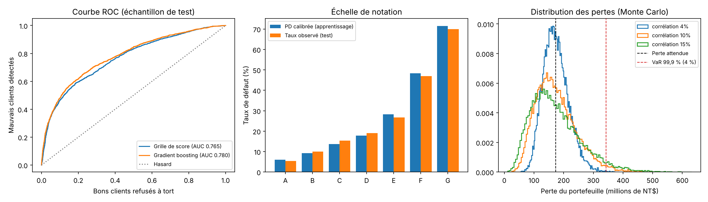

# Risque de crédit : grille de score, PD, perte attendue et capital Bâle

La chaîne complète du risque de crédit sur un vrai portefeuille de 30 000 cartes de crédit. Elle va de la grille de score, construite comme en banque, jusqu'à la perte attendue, au capital réglementaire Bâle IRB et à la VaR crédit du portefeuille par Monte Carlo. Le projet est vérifié par 12 tests.



## Données

30 000 titulaires de cartes de crédit à Taïwan, d'avril à septembre 2005 (UCI Machine Learning Repository, *Default of Credit Card Clients*, Yeh et Lien, 2009, licence CC BY 4.0). Pour chaque client : plafond, 6 mois de retards de paiement, de relevés et de remboursements. La cible est le défaut de paiement le mois suivant. Taux de défaut : **22,1 %**. C'est un échantillon enrichi en défauts : un vrai portefeuille de cartes est plutôt autour de 2 à 5 %.

**Variables exclues : le sexe, la situation familiale et l'âge.** Ce sont des critères de discrimination interdits ou sensibles pour l'octroi de crédit (en France, article 225-1 du Code pénal ; en Europe, directive 2004/113/CE et RGPD). La grille n'utilise que le comportement de paiement.

Échantillons : 70 % pour l'apprentissage (21 000 clients) et 30 % pour le test (9 000), tirés au hasard en respectant le taux de défaut. Tout est appris sur l'apprentissage et jugé sur le test.

## 1. La grille de score

La méthode standard des banques est une **régression logistique sur des variables découpées en classes**. Elle est interprétable, stable, et facile à expliquer à un régulateur ou à un client refusé.

1. **Découpage** de chaque variable en classes (quantiles).
2. **Weight of Evidence** de chaque classe : $\text{WoE} = \ln(\text{part des bons} / \text{part des mauvais})$. Une WoE positive signale une classe plus sûre que la moyenne.
3. **Information Value** pour sélectionner les variables : $IV = \sum (\text{part des bons} - \text{part des mauvais}) \times \text{WoE}$. On garde les variables avec IV ≥ 0,02.
4. **Régression logistique** sur les WoE. Tous les coefficients doivent être négatifs. Une variable de signe incohérent, signe de redondance avec une autre, est retirée.
5. **Points** : 600 points pour une cote de 50 bons pour 1 mauvais, et +20 points chaque fois que la cote double.

| Variable | IV | Coefficient |
|---|---|---|
| Retard du dernier mois | 0,887 | −0,621 |
| Retard maximal sur 6 mois | 0,761 | −0,370 |
| Nombre de mois en retard | 0,687 | −0,129 |
| Plafond de la carte | 0,174 | −0,256 |
| Dernier remboursement | 0,128 | −0,458 |
| Taux de remboursement sur 6 mois | 0,123 | −0,150 |
| Utilisation moyenne sur 6 mois | 0,116 | −0,303 |
| Hausse de l'utilisation | 0,077 | −0,371 |
| Utilisation du dernier mois | 0,066 | *retirée : signe incohérent (redondante avec l'utilisation moyenne)* |
| Niveau d'études | 0,035 | −0,326 |

Extrait de la grille, pour le retard du dernier mois :

| Situation | WoE | Points |
|---|---|---|
| Crédit renouvelable utilisé normalement (0) | +0,67 | 70 |
| Payé intégralement ou carte non utilisée (−1, −2) | +0,43 | 66 |
| 1 mois de retard | −0,60 | 47 |
| 2 mois de retard ou plus | −2,10 | 21 |

## 2. Performance : grille contre « boîte noire »

| Modèle (échantillon de test) | AUC | Gini | KS | Brier |
|---|---|---|---|---|
| **Grille de score** (régression logistique) | 0,765 | 0,531 | 0,403 | 0,139 |
| Gradient boosting (challenger) | 0,780 | 0,561 | 0,426 | 0,135 |

- **AUC** : probabilité qu'un mauvais client tiré au hasard ait une PD plus élevée qu'un bon. **Gini** = 2 AUC − 1. **KS** : écart maximal entre les répartitions des bons et des mauvais.
- Le gradient boosting gagne 3 points de Gini, mais c'est une boîte noire. Chez un prêteur réglementé, il faut pouvoir expliquer un refus de crédit au client (RGPD, article 22) et justifier le modèle au superviseur. Le gain ne justifie pas la perte d'interprétabilité. Il sert de **challenger**, pour vérifier que la grille ne laisse pas beaucoup de performance sur la table.
- Apprentissage : AUC 0,774 ; test : 0,765. Le surapprentissage est limité. **PSI** entre les scores d'apprentissage et de test : 0,002 (< 0,1), donc une population stable.

## 3. Échelle de notation et calibration des PD

La PD brute de la régression classe bien les clients, mais elle est mal calibrée : le test de Hosmer-Lemeshow la rejette (p < 0,001). Comme en banque, les clients sont donc regroupés en **7 classes de notation**. La PD de chaque classe est le **taux de défaut observé** dans cette classe sur l'apprentissage. On vérifie ensuite sur le test :

| Classe | Clients (test) | PD calibrée | Taux observé (test) | Test binomial p | Verdict |
|---|---|---|---|---|---|
| A | 1 313 | 6,1 % | 5,3 % | 0,30 | ✅ |
| B | 1 832 | 9,3 % | 9,9 % | 0,33 | ✅ |
| C | 1 799 | 13,7 % | 15,3 % | 0,06 | ✅ |
| D | 1 407 | 17,8 % | 19,0 % | 0,22 | ✅ |
| E | 1 051 | 28,2 % | 26,7 % | 0,30 | ✅ |
| F | 882 | 48,3 % | 46,9 % | 0,44 | ✅ |
| G | 716 | 71,5 % | 70,0 % | 0,36 | ✅ |

Test global sur les 7 classes : p = 0,19. Les PD sont croissantes d'une classe à l'autre, et chaque classe est confirmée sur des clients jamais vus.

## 4. Perte attendue et capital réglementaire (Bâle IRB)

$$EL = PD \times LGD \times EAD$$

- **EAD** (exposition au défaut) = montant utilisé + 75 % du montant non utilisé : un client en difficulté tire souvent sur sa ligne avant de faire défaut.
- **LGD** (perte en cas de défaut) = 80 %, hypothèse usuelle pour un crédit renouvelable non garanti.
- **Capital** : formule de Vasicek de Bâle pour la clientèle de détail renouvelable (corrélation fixée à 4 %). Le capital couvre la perte **inattendue** dans le scénario économique à 99,9 % :

$$K = LGD \times \left[ \Phi\!\left( \frac{\Phi^{-1}(PD) + \sqrt{\rho}\,\Phi^{-1}(0{,}999)}{\sqrt{1-\rho}} \right) - PD \right], \qquad RWA = 12{,}5 \times K \times EAD$$

Portefeuille de test (montants en millions de dollars taïwanais) :

| Classe | PD | EAD | Perte attendue | Capital | Capital / EAD | Pondération |
|---|---|---|---|---|---|---|
| A | 6,1 % | 328 | 15,9 | 29,0 | 8,8 % | 110 % |
| B | 9,3 % | 323 | 24,0 | 36,9 | 11,4 % | 143 % |
| C | 13,7 % | 221 | 24,3 | 31,2 | 14,1 % | 177 % |
| D | 17,8 % | 123 | 17,4 | 19,6 | 16,0 % | 200 % |
| E | 28,2 % | 110 | 24,7 | 20,6 | 18,8 % | 235 % |
| F | 48,3 % | 95 | 36,8 | 18,2 | 19,1 % | 239 % |
| G | 71,5 % | 52 | 30,0 | 7,2 | 13,7 % | 172 % |
| **Total** | 17,3 % | **1 252** | **173,2** | **162,7** | 13,0 % | 162 % |

- **Contrôle a posteriori** : la perte réellement subie sur les 9 000 clients de test vaut 180,8 M (14,4 % de l'EAD), pour 173,2 M prévus (13,8 %).
- **Le capital baisse pour la classe G.** Avec une PD de 71,5 %, l'essentiel de la perte est *attendu* : il est couvert par les provisions, pas par les fonds propres. Le capital couvre la perte *inattendue*.

## 5. VaR crédit du portefeuille (Monte Carlo)

Modèle de Vasicek à un facteur : l'emprunteur $i$ fait défaut si $\sqrt{\rho}\,Z + \sqrt{1-\rho}\,\varepsilon_i < \Phi^{-1}(PD_i)$. $Z$ est la conjoncture économique, commune à tous ; $\varepsilon_i$ est le risque propre au client. 20 000 scénarios.

| | Millions de NT$ |
|---|---|
| Perte moyenne simulée | 173,0 (perte attendue analytique : 173,2) |
| VaR 99,9 % | 343,0 |
| Perte inattendue (VaR − perte moyenne) | 170,1 |
| Capital Bâle IRB | 162,7 (**+4,5 %** pour la simulation) |

L'écart de 4,5 % vient de la **granularité**. La formule de Bâle suppose un portefeuille infiniment divisé (le risque propre de chaque client disparaît), alors que celui-ci compte 9 000 clients de tailles inégales.

**La corrélation fait le risque extrême :**

| Corrélation | VaR 99 % | VaR 99,9 % | Écart-type des pertes |
|---|---|---|---|
| 4 % (Bâle, cartes de crédit) | 286 | 339 | 43 |
| 10 % | 366 | 459 | 68 |
| 15 % (Bâle, crédit immobilier) | 420 | 541 | 84 |

La perte moyenne ne change pas, mais la queue s'épaissit : quand les clients dépendent davantage de la même conjoncture, ils font défaut ensemble.

## Ce que vérifient les tests

- Le sexe, la situation familiale et l'âge ne sont jamais utilisés ; l'EAD est toujours au moins égale au montant utilisé.
- WoE et IV calculés à la main ; les classes sont apprises sur l'apprentissage, une valeur jamais vue est traitée de façon neutre ; une variable de pur bruit a une IV inférieure à 0,02 et est écartée.
- Sur des données simulées dont on connaît la vraie relation, la grille atteint presque l'AUC du vrai modèle, avec des coefficients tous négatifs.
- **La somme des points d'un client redonne exactement son score**, et doubler la cote ajoute exactement 20 points.
- AUC, Gini et KS valent 1 pour un classement parfait et 0 pour un score au hasard ; le PSI détecte un changement de population.
- **Hosmer-Lemeshow** : avec les vraies PD, il ne rejette qu'environ 5 % du temps ; avec des PD biaisées de 50 %, toujours (40 simulations).
- L'échelle de notation est croissante, et calibrée sur un autre échantillon.
- Capital Bâle : nul quand la PD vaut 100 % ; RWA = 12,5 × K × EAD.
- **Le Monte Carlo retrouve la formule de Vasicek** sur un grand portefeuille homogène.

## Lancer le projet

```bash
pip install -r requirements.txt
python -m pytest          # 12 tests
python scripts/demo.py    # figure + tableaux
```

Les données (`data/credit_card_default.csv`) sont incluses, converties depuis le fichier Excel de l'UCI.

## Limites et pistes

- Données de 2005, d'une seule banque, enrichies en défauts : les niveaux de PD ne sont pas transposables à un portefeuille actuel.
- Pas de dimension temporelle : il faudrait une validation hors période et une **PD « à travers le cycle »** (moyenne de long terme), exigée par Bâle.
- LGD et CCF sont des hypothèses fixes : en IRB avancé, ils sont modélisés à partir des recouvrements observés.
- Pistes : **IFRS 9** (pertes attendues à 12 mois et à maturité, classement en 3 *stages*), PD conditionnelle aux scénarios macroéconomiques pour les stress tests de crédit, ajustement de granularité analytique.
