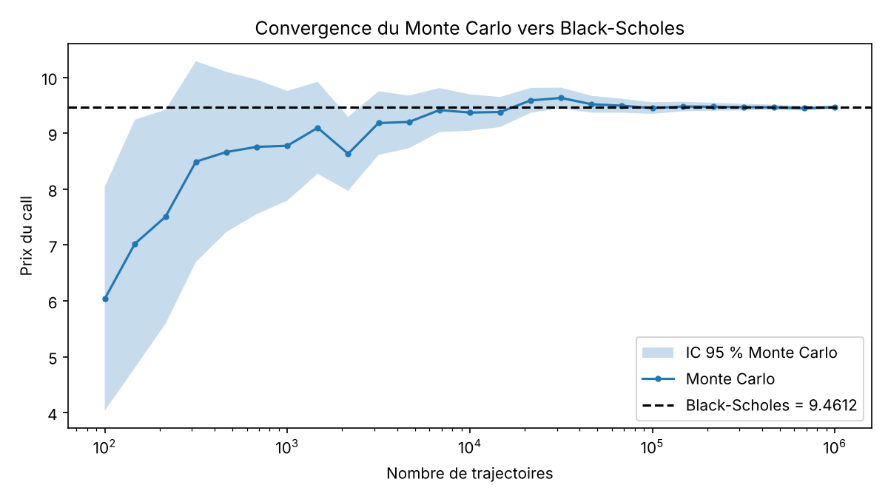
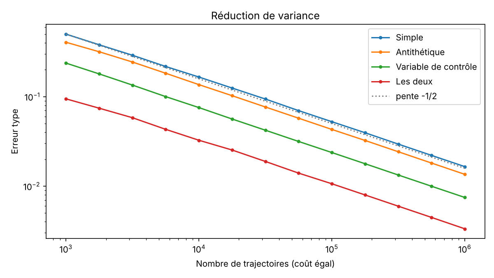

# Option pricer : Black-Scholes et Monte Carlo

Pricer d'options européennes et asiatiques en Python. Ce projet met en œuvre la formule fermée de Black-Scholes, les grecques et la volatilité implicite. Il compare ensuite ces résultats à un Monte Carlo avec réduction de variance. Chaque résultat est vérifié par des tests automatiques (40 tests).



## Ce que fait le projet

| Module | Contenu |
|---|---|
| `pricer/black_scholes.py` | Prix call/put (avec dividende continu q), grecques analytiques (delta, gamma, vega, theta, rho), volatilité implicite (méthode de Brent) |
| `pricer/monte_carlo.py` | Monte Carlo européen (simple, antithétique, variable de contrôle), grecques par différences finies, options asiatiques (moyenne arithmétique et géométrique) |
| `tests/` | 40 tests : valeurs de référence, parité call-put, bornes d'arbitrage, convergence, réduction de variance |
| `scripts/demo.py` | Génère les figures et les tableaux ci-dessous |

## Modèle

Sous la probabilité risque neutre, le sous-jacent suit un mouvement brownien géométrique :

$$dS_t = (r - q)\,S_t\,dt + \sigma\,S_t\,dW_t
\qquad\Rightarrow\qquad
S_T = S_0\,e^{(r - q - \sigma^2/2)T + \sigma\sqrt{T}\,Z},\quad Z \sim \mathcal{N}(0,1)$$

**Black-Scholes** (call) :

$$C = S_0 e^{-qT} N(d_1) - K e^{-rT} N(d_2),
\qquad d_1 = \frac{\ln(S_0/K) + (r - q + \sigma^2/2)T}{\sigma\sqrt{T}},
\qquad d_2 = d_1 - \sigma\sqrt{T}$$

**Monte Carlo** : le prix est la moyenne actualisée des payoffs simulés.

$$\hat{C}_N = e^{-rT}\,\frac{1}{N}\sum_{i=1}^{N} \max(S_T^{(i)} - K,\,0),
\qquad \text{erreur type} = \frac{\hat{\sigma}}{\sqrt{N}}$$

## Réduction de variance

- **Variables antithétiques** : chaque tirage $Z$ est utilisé avec son opposé $-Z$.
- **Variable de contrôle** : $X = e^{-rT}S_T$, dont l'espérance est connue ($S_0 e^{-qT}$). On utilise $Y - b\,(X - \mathbb{E}[X])$ avec $b = \mathrm{Cov}(X,Y)/\mathrm{Var}(X)$.

Les comparaisons se font **à coût égal**, c'est-à-dire avec le même nombre total de trajectoires.



Call européen : S = 100, K = 105, T = 1 an, r = 5 %, σ = 25 %, q = 1 %. Black-Scholes = **9,4612**. N = 100 000 trajectoires.

| Méthode | Prix MC | Erreur type | Écart à BS | Gain de variance |
|---|---|---|---|---|
| Simple | 9,4508 | 0,0525 | −0,0104 | 1,0 |
| Antithétique | 9,4845 | 0,0430 | +0,0233 | 1,5 |
| Variable de contrôle | 9,4975 | 0,0237 | +0,0363 | 4,9 |
| Antithétique + contrôle | 9,4498 | 0,0106 | −0,0114 | **24,4** |

Tous les écarts à Black-Scholes restent dans ±2 erreurs types. Combiner les deux méthodes divise la variance par 24 : il faudrait 24 fois plus de trajectoires pour obtenir la même précision avec le Monte Carlo simple.

## Grecques

Elles sont calculées par différences finies centrées, avec des **nombres aléatoires communs** : les mêmes tirages servent pour les prix « bumpés ». Sans cela, le bruit Monte Carlo écraserait la petite différence entre deux prix.

| Grecque | Analytique | Monte Carlo (400 000 trajectoires) |
|---|---|---|
| Delta | 0,5305 | 0,5308 |
| Gamma | 0,0157 | 0,0157 |
| Vega | 39,34 | 39,50 |

## Option asiatique

Il s'agit d'un call sur la moyenne arithmétique de 12 fixings mensuels. Cette option n'a pas de formule fermée. L'asiatique à moyenne **géométrique**, elle, en a une. Elle est très corrélée à l'arithmétique, ce qui en fait une excellente variable de contrôle.

| | Prix | Erreur type |
|---|---|---|
| Monte Carlo simple | 4,8244 | 0,0280 |
| Avec contrôle géométrique | 4,8183 | 0,0011 |

La variance est **divisée par environ 650** à coût égal.

## Comment le projet est vérifié

- Valeurs de référence de Hull (call 4,76 ; put 0,81).
- **Parité call-put** $C - P = S e^{-qT} - K e^{-rT}$, à $10^{-12}$ près.
- **Bornes d'arbitrage** respectées.
- **Grecques analytiques** égales aux dérivées numériques de la formule fermée.
- **Volatilité implicite** : en repartant du prix, on retrouve la volatilité d'origine.
- **Monte Carlo** : il converge vers Black-Scholes (écart inférieur à 4 erreurs types), dans les 8 configurations testées.
- **Vitesse de convergence** : l'erreur décroît en $1/\sqrt{N}$, avec une pente log-log de −0,5 ± 0,02.
- **Réduction de variance** effective, à coût égal.
- **Asiatique géométrique** : le Monte Carlo correspond à la formule fermée. Avec un seul fixing, elle redonne exactement Black-Scholes.

## Lancer le projet

```bash
pip install -r requirements.txt
python -m pytest            # 40 tests
python scripts/demo.py      # figures + tableaux
```

```python
from pricer import bs_price, mc_european

bs_price(100, 105, 1.0, 0.05, 0.25, kind="call", q=0.01)            # 9.4612
mc_european(100, 105, 1.0, 0.05, 0.25, kind="call", q=0.01,
            n_paths=100_000, seed=42, antithetic=True, control_variate=True)
```

## Limites

- Volatilité et taux constants : le smile de volatilité n'est pas modélisé.
- Options européennes et asiatiques uniquement. Pas d'exercice anticipé : les options américaines demanderaient la méthode de Longstaff-Schwartz.
- Le coefficient $b$ de la variable de contrôle est estimé sur le même échantillon, ce qui introduit un biais en $O(1/N)$, négligeable ici.

## Pistes

Options américaines (Longstaff-Schwartz), options à barrière, nombres quasi-aléatoires (suites de Sobol), calibration sur une surface de volatilité implicite réelle.
