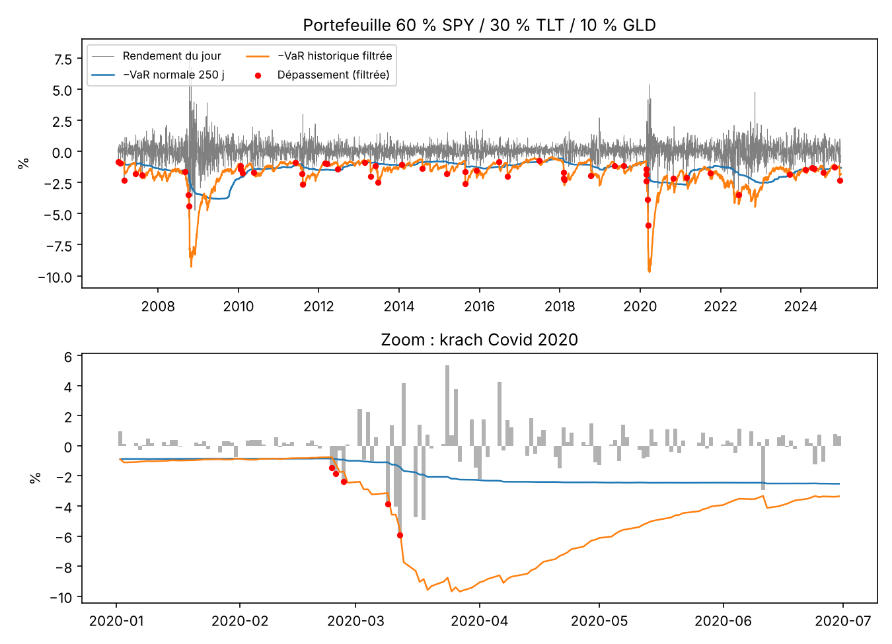
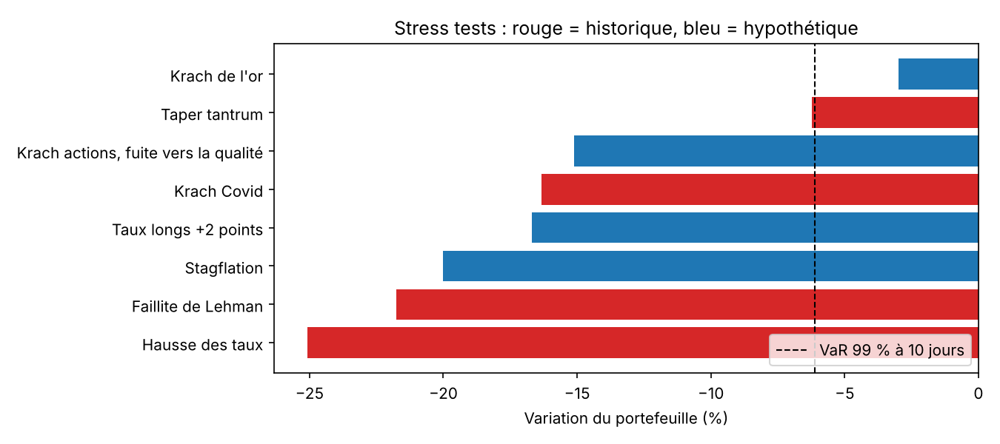

# Modèle de risque : VaR et Expected Shortfall

Mesure, backtest et stress test du risque d'un portefeuille diversifié (60 % actions SPY, 30 % obligations longues TLT, 10 % or GLD) sur 2005-2024. Le projet compare 5 méthodes de VaR, dont un GARCH à queues épaisses, et les vérifie par des tests statistiques (Kupiec, Christoffersen, feux de Bâle). Il ajoute des stress tests historiques, hypothétiques et inversés, les mesures réglementaires (ES 97,5 %, VaR stressée, capital Bâle 2.5) et la théorie des valeurs extrêmes, puis décompose le risque par actif. Il est vérifié par 33 tests, et un [rapport de validation](VALIDATION.md) examine le modèle retenu comme le ferait une équipe de validation indépendante.



## Les deux mesures

- **VaR 99 % à 1 jour** : la perte qu'on ne dépasse pas 99 jours sur 100.
- **Expected Shortfall (ES) 99 %** : la perte **moyenne** les 1 % de jours où l'on dépasse la VaR. Elle dit « quand ça va mal, ça va mal de combien ? ». C'est la mesure retenue par la réglementation bancaire actuelle (Bâle III / FRTB).

| Sur 20 ans | VaR 99 % | ES 99 % |
|---|---|---|
| Historique (les vrais pires jours) | 1,93 % | **2,84 %** |
| Loi normale (même moyenne, même volatilité) | 1,60 % | 1,84 % |

La loi normale sous-estime l'ES de **35 %**. Les krachs sont bien plus fréquents et violents que ne le prévoit la courbe en cloche : on parle de **queues épaisses**. Pire jour : −5,95 % le 12 mars 2020, soit 8,5 écarts-types : sous la loi normale, un tel jour arriverait moins d'une fois tous les 10¹⁴ ans.

## Les 5 méthodes de prévision

Chaque matin, on prévoit la VaR du jour **avec les seules données de la veille et avant**. Un test vérifie qu'aucune méthode ne regarde le futur.

| Méthode | Principe | Point fort | Point faible |
|---|---|---|---|
| **Historique 250 j** | Le 1 % des pires jours de la dernière année | Aucune hypothèse de loi | Réagit lentement, et estime mal un quantile extrême avec seulement 250 jours |
| **Normale 250 j** | Moyenne et écart-type de la dernière année, loi normale | Simple | Queues trop fines, réagit lentement |
| **Normale EWMA** | Volatilité où les jours récents pèsent plus, $\sigma_t^2 = \lambda\sigma_{t-1}^2 + (1-\lambda)r_{t-1}^2$, $\lambda = 0{,}94$ (RiskMetrics) | Réagit vite | Garde l'hypothèse normale |
| **Historique filtrée** | Rendements divisés par leur volatilité EWMA, quantile historique sur 500 j, puis multiplié par la volatilité prévue | Queues réelles **et** réaction rapide | Plus complexe |
| **GARCH(1,1) Student** | $\sigma_t^2 = \omega + a\,r_{t-1}^2 + b\,\sigma_{t-1}^2$, loi de Student, paramètres réestimés chaque 1er janvier par maximum de vraisemblance | Volatilité qui revient vers sa moyenne, queues épaisses, modèle statistique complet | Paramètres à estimer, risque de modèle |

## Backtest : la VaR a-t-elle tenu sa promesse ?

Du 3 janvier 2007 au 31 décembre 2024 (4 530 jours ; même période pour toutes les méthodes). Avec une VaR 99 %, on attend **45 dépassements**.

| Méthode | Dépassements | Taux | Kupiec p | Indépendance p | Pire fenêtre de 250 j | Temps en zone rouge |
|---|---|---|---|---|---|---|
| Historique 250 j | 65 | 1,43 % | 0,006 | < 0,001 | 13 (rouge) | 6 % |
| Normale 250 j | 101 | 2,23 % | < 0,001 | < 0,001 | 17 (rouge) | 19 % |
| Normale EWMA | 88 | 1,94 % | < 0,001 | 0,036 | 12 (rouge) | 5 % |
| **Historique filtrée** | **53** | **1,17 %** | **0,263** | 0,003 | **7 (orange)** | **0 %** |
| GARCH(1,1) Student | 69 | 1,52 % | 0,001 | **0,113** | 10 (rouge) | 1 % |

- **Test de Kupiec** : le nombre de dépassements est-il compatible avec 1 % ? Une p-value inférieure à 5 % signifie que le modèle est rejeté. Seule l'historique filtrée passe.
- **Test de Christoffersen** : les dépassements sont-ils dispersés, ou arrivent-ils en grappes ? Seul le GARCH passe : sa volatilité réagit au choc de la veille. Les autres modèles voient plusieurs dépassements s'enchaîner au début de chaque crise avant de s'adapter. Les deux tests se complètent : la filtrée a le bon nombre de dépassements mais en grappes, le GARCH des dépassements dispersés mais un peu trop nombreux.
- **Feux de Bâle** : sur 250 jours, 0 à 4 dépassements donnent le vert, 5 à 9 l'orange, 10 et plus le rouge (une banque en rouge voit son capital réglementaire augmenter). L'historique filtrée n'est jamais passée au rouge.

Le zoom 2020 montre la différence. La VaR normale 250 jours reste presque plate pendant le krach, parce qu'une année de calme pèse encore sur la moyenne. La filtrée s'adapte en quelques jours.

Dépassements par année :

| | 2008 | 2020 | 2022 |
|---|---|---|---|
| Historique 250 j | 13 | 8 | 7 |
| Normale 250 j | 16 | 9 | 16 |
| Normale EWMA | 5 | 11 | 8 |
| Historique filtrée | 3 | 6 | 1 |
| GARCH(1,1) Student | 5 | 9 | 5 |

> **Honnêteté méthodologique.** Les réglages de la méthode filtrée (λ = 0,94, fenêtre de 500 jours) ont été choisis après en avoir essayé 6, sur ces mêmes données. Son succès est donc en partie optimiste : c'est le surapprentissage mis en évidence dans le [projet 2](../backtester/). Les 3 autres méthodes utilisent leurs réglages standards, non optimisés.

## Stress tests

La VaR décrit les jours « normalement mauvais ». Les stress tests répondent à une autre question : **que se passerait-il en cas de crise ?**



**Historiques** : on rejoue une crise passée sur le portefeuille.

| Scénario | SPY | TLT | GLD | Portefeuille |
|---|---|---|---|---|
| Faillite de Lehman (12/09/2008 → 09/03/2009) | −45,2 % | +11,3 % | +19,9 % | −21,8 % |
| Taper tantrum (21/05/2013 → 24/06/2013) | −5,6 % | −7,4 % | −6,7 % | −6,2 % |
| Krach Covid (19/02/2020 → 23/03/2020) | −33,7 % | +14,2 % | −3,6 % | −16,3 % |
| **Hausse des taux (31/12/2021 → 14/10/2022)** | −23,8 % | **−32,4 %** | −10,5 % | **−25,1 %** |

Le pire scénario n'est pas 2008 mais **2022**. En 2008, les obligations et l'or ont amorti la chute des actions ; en 2022, avec l'inflation et la hausse des taux, les trois actifs ont baissé ensemble. La diversification a disparu au pire moment.

**Hypothétiques** : on imagine des chocs, y compris jamais vus. Pour TLT (duration d'environ 17), +2 points de taux donnent environ −34 %.

| Scénario | SPY | TLT | GLD | Portefeuille |
|---|---|---|---|---|
| Krach actions, fuite vers la qualité | −30 % | +8 % | +5 % | −15,1 % |
| Taux longs +2 points | −10 % | −34 % | −5 % | −16,7 % |
| Stagflation (actions et obligations chutent) | −25 % | −20 % | +10 % | −20,0 % |
| Krach de l'or | 0 % | 0 % | −30 % | −3,0 % |

**Inversé** (*reverse stress test*) : on part d'une perte jugée inacceptable et on cherche le scénario le plus plausible qui la provoque. Sous l'hypothèse normale, c'est $x^* = -L\,\Sigma w / (w^\top \Sigma w)$, le choc qui minimise la distance de Mahalanobis.

| Perte sur 1 mois | Scénario le plus plausible | Distance | Fréquence selon la loi normale |
|---|---|---|---|
| −10 % | SPY −15,3 %, TLT −1,2 %, GLD −4,4 % | 3,1 écarts-types | une fois tous les 85 ans |
| −20 % | SPY −30,6 %, TLT −2,4 %, GLD −8,8 % | 6,2 écarts-types | une fois tous les 280 millions d'années |

Le krach Covid a fait −16,3 % **en un mois**, alors que la loi normale ne prévoit −10 % qu'une fois tous les 85 ans. Le stress inversé sert à identifier les vulnérabilités : ici, presque tout le risque passe par les actions.

## Mesures réglementaires

**Horizon de 10 jours.** La réglementation demande une VaR à 10 jours. La règle de la racine du temps ($\text{VaR}_{10j} = \sqrt{10}\,\text{VaR}_{1j}$) suppose des jours indépendants. Sur ce portefeuille, elle reste proche des rendements réels sur 10 jours, et légèrement prudente :

| | Racine du temps | Rendements réels sur 10 jours |
|---|---|---|
| VaR 99 % | 6,11 % | 6,01 % |
| ES 97,5 % | 6,69 % | 6,39 % |

**Expected Shortfall 97,5 %.** Depuis la FRTB (*Fundamental Review of the Trading Book*, Bâle III), l'ES 97,5 % remplace la VaR 99 %. Pour une loi normale les deux sont presque égales (2,34 σ contre 2,33 σ), mais l'ES voit ce qui se passe au-delà du seuil. Sur les 250 derniers jours : ES 97,5 % = 1,62 % à 1 jour.

**VaR stressée et capital (Bâle 2.5).** Après 2008, Bâle 2.5 a ajouté une VaR calibrée sur la pire année de l'historique. Le capital vaut :

$$\text{Capital} = m \times (\text{VaR}_{10j} + \text{VaR stressée}_{10j}), \qquad m = 3 + \text{majoration selon les feux du backtest}$$

| | 1 jour | 10 jours |
|---|---|---|
| VaR 99 % (250 derniers jours) | 1,60 % | 5,1 % |
| VaR stressée (pire année : 22/03/2019 → 18/03/2020, Covid) | 4,41 % | 13,9 % |
| Dépassements sur 250 jours (historique filtrée) | 6, zone orange | majoration 0,5, donc m = 3,5 |
| **Capital** | | **3,5 × (5,1 % + 13,9 %) = 66,5 % du portefeuille** |

Une banque qui détiendrait ce portefeuille dans son activité de marché devrait immobiliser 66 € de fonds propres pour 100 € investis. C'est pourquoi les salles de marché couvrent leurs positions au lieu de garder des paris directionnels. On voit aussi que la VaR stressée pèse près de trois fois plus que la VaR courante.

## GARCH et valeurs extrêmes

**GARCH(1,1) Student** estimé sur 20 ans : $a$ = 0,100, $b$ = 0,890, persistance $a + b$ = 0,990, 7,4 degrés de liberté, volatilité de long terme 11,8 %. Un choc de volatilité met environ **69 jours** à se résorber de moitié, ce qui explique les grappes de dépassements. Les 7,4 degrés de liberté confirment des queues plus épaisses que la normale, même une fois la volatilité variable prise en compte.

**Théorie des valeurs extrêmes** (méthode des excès au-delà d'un seuil). Au-delà du 95e centile des pertes, les excès suivent une loi de Pareto généralisée. On obtient $\xi$ = 0,20 > 0 : des queues épaisses, de type puissance.

| Niveau | VaR historique | VaR normale | **VaR EVT** | ES historique | ES normale | **ES EVT** |
|---|---|---|---|---|---|---|
| 99 % | 1,93 % | 1,60 % | 1,98 % | 2,84 % | 1,84 % | 2,85 % |
| 99,5 % | 2,42 % | 1,78 % | 2,50 % | 3,48 % | 2,00 % | 3,50 % |
| 99,9 % | 4,38 % | 2,14 % | 4,01 % | 5,04 % | 2,34 % | 5,40 % |

À 99,9 %, la loi normale divise le risque par deux. L'historique ne repose plus que sur 5 jours. L'EVT, elle, extrapole la queue à partir de 252 excès : c'est la méthode adaptée aux événements rares.

## Erreur d'estimation

Même sur des données **parfaitement normales** (simulées), une VaR historique estimée sur 250 jours est dépassée environ **1,3 %** du temps au lieu de 1 %. Le 1 % des pires jours d'une année, c'est 2 ou 3 observations : l'estimation est bruitée, et ce bruit joue en moyenne dans le mauvais sens. Sur 1 000 jours, le taux revient à 1,08 %. Un test le vérifie.

## D'où vient le risque du portefeuille ?

La volatilité du portefeuille vaut $\sigma_p = \sqrt{w^\top \Sigma w}$. Chaque actif y contribue pour $w_i (\Sigma w)_i / \sigma_p$, et ces contributions s'additionnent exactement à $\sigma_p$ (théorème d'Euler).

| Actif | Poids | Volatilité journalière | Part du risque |
|---|---|---|---|
| SPY (actions) | 60 % | 1,20 % | **92 %** |
| TLT (obligations) | 30 % | 0,93 % | 4 % |
| GLD (or) | 10 % | 1,11 % | 4 % |

Avec 60 % du capital, les actions portent **92 % du risque**. Les obligations, corrélées négativement aux actions (−0,32), en compensent une partie. Un portefeuille « 60/40 » est en réalité un pari presque entièrement sur les actions. C'est le point de départ de l'allocation en **parité de risque**.

## Ce que vérifient les tests

- Valeurs de référence de la loi normale (VaR 2,326 σ, ES 2,665 σ).
- VaR et ES historiques = valeurs théoriques sur un grand échantillon normal.
- ES ≥ VaR.
- **Aucune prévision ne regarde le futur** : modifier le rendement du jour ne change pas la prévision du jour (pour les 5 méthodes).
- Sur données normales simulées : taux de dépassement plausible, test de Kupiec réussi avec un historique long, effet de l'erreur d'estimation à 250 jours.
- Test de Kupiec sur des cas connus ; test de Christoffersen qui détecte des grappes artificielles.
- Feux de Bâle et majoration du multiplicateur ; formule du capital.
- **Stress inversé** : le choc trouvé produit exactement la perte visée, et aucun autre choc de même perte n'est plus plausible (200 essais au hasard).
- **GARCH** : le filtre reproduit la récurrence ; l'estimation retrouve les paramètres d'une série simulée.
- **EVT** : sur une loi de Student, les quantiles extrêmes (99,9 % et 99,99 %) sont estimés à moins de 10 % près, quand la loi normale se trompe de plus de 25 %.
- La période stressée retrouve une crise injectée dans des données simulées.
- Les contributions au risque s'additionnent exactement à la VaR du portefeuille.

## Lancer le projet

Les prix sont ceux téléchargés par le [backtester](../backtester/) (`backtester/data/`).

```bash
pip install -r requirements.txt
python -m pytest                 # 33 tests
python scripts/demo.py           # backtest des 5 méthodes, contributions au risque
python scripts/stress_demo.py    # stress tests, réglementaire, GARCH, valeurs extrêmes
```

## Limites et pistes

- VaR à 1 jour. Le passage à 10 jours par la racine du temps (`scale_to_horizon`) suppose des jours indépendants, ce que contredisent les grappes de volatilité.
- Poids constants, rééquilibrés chaque jour.
- Le GARCH est estimé sur le portefeuille agrégé, pas actif par actif (pas de GARCH multivarié ni de corrélations dynamiques).
- Le capital Bâle 2.5 est calculé sur la VaR historique simple ; la FRTB complète ajouterait des horizons de liquidité par facteur de risque.
- Pistes : corrélations dynamiques (DCC-GARCH), VaR Monte Carlo multi-actifs, horizons de liquidité FRTB.
