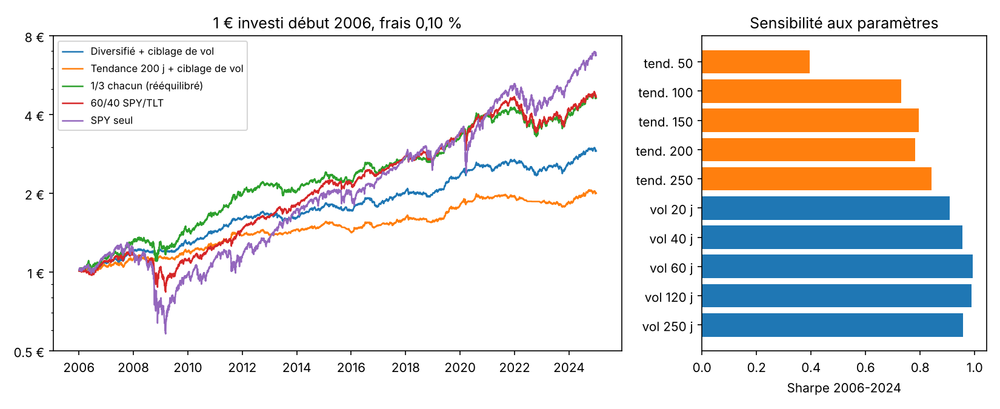

# Stratégie robuste : tendance, ciblage de volatilité et walk-forward

Construire une stratégie multi-actifs (actions SPY, obligations TLT, or GLD) et, surtout, **vérifier honnêtement si sa performance est réelle ou due au surapprentissage**. Le projet utilise la validation walk-forward, la sensibilité aux paramètres, les sous-périodes, le bootstrap par blocs et le Deflated Sharpe Ratio. Il réutilise le moteur du [projet 2](../backtester/) et est vérifié par 11 tests.



## La stratégie testée

Chaque soir, pour chaque actif, avec un budget de 1/3 chacun :

1. **Tendance** : investi si le prix est au-dessus de sa moyenne mobile de *n* jours, sinon en cash.
2. **Ciblage de volatilité** : position = 10 % / volatilité des 60 derniers jours, plafonnée à 1 (pas d'effet de levier). On détient moins d'un actif quand il devient agité, et chaque actif apporte à peu près le même risque.

Le signal est décalé d'un jour par le moteur, et les frais (0,10 % par transaction) s'appliquent à chaque ajustement de position.

## Résultat principal : la tendance n'apporte rien, la diversification si

On décompose la stratégie, en retirant un ingrédient à la fois. Période 2006-2024 (2005 sert d'historique) :

| Stratégie | Sharpe | Rendement annuel | Volatilité | Pire chute | 2008 | 2022 |
|---|---|---|---|---|---|---|
| **Diversifié + ciblage de vol** | **0,99** | 5,7 % | 5,8 % | −13,2 % | +1,2 % | −9,5 % |
| Tendance 200 j + ciblage de vol | 0,78 | 3,7 % | 4,8 % | −11,0 % | +2,4 % | −5,8 % |
| Tendance 200 j seule | 0,67 | 4,7 % | 7,4 % | −16,4 % | +2,7 % | −10,2 % |
| 1/3 chacun (rééquilibré) | 0,88 | 8,3 % | 9,7 % | −22,7 % | −0,2 % | −16,7 % |
| 60/40 SPY/TLT | 0,78 | 8,4 % | 11,2 % | −29,9 % | −11,8 % | −22,8 % |
| SPY seul | 0,62 | 10,5 % | 19,4 % | −55,2 % | −36,8 % | −18,2 % |

- **Ajouter le filtre de tendance fait baisser le Sharpe** de 0,99 à 0,78. Il protège un peu mieux dans les crises (2008, 2022), mais il rate trop de hausses et paie trop de faux signaux.
- **La version retenue** est le portefeuille diversifié avec ciblage de volatilité : le meilleur Sharpe, et une pire chute de −13 % contre −30 % pour le 60/40.
- **Le prix à payer** : une volatilité faible (5,8 %), donc un rendement faible (5,7 % par an). Sans effet de levier, elle enrichit moins que le 60/40 ou le SPY. Le Sharpe mesure l'efficacité, pas la richesse finale.

## Test 1 : walk-forward (choisir sans connaître l'avenir)

Chaque 1er janvier de 2010 à 2024, on choisit la fenêtre de tendance (50, 100, 150, 200 ou 250 jours) qui a le meilleur Sharpe sur les 5 années précédentes, et on l'applique à l'année qui commence. La performance n'est faite **que d'années que le choix n'avait pas vues**.

| 2010-2024 | Sharpe | Rendement | Volatilité | Pire chute |
|---|---|---|---|---|
| Tendance, walk-forward | 0,83 | 3,8 % | 4,7 % | −9,4 % |
| Tendance, meilleure fenêtre **a posteriori** (150 j) | 0,87 | 4,1 % | 4,8 % | −9,4 % |
| Diversifié + ciblage de vol | **0,95** | 5,6 % | 5,9 % | −13,2 % |

Même avec le meilleur réglage choisi après coup, ce qui revient à tricher, la tendance reste derrière la version sans tendance. Fenêtres choisies : 250 j (2010-2013), 150 j (2014-2020), 200 j (2021), 250 j (2022-2024). Le choix change dans le temps, signe que le « meilleur » paramètre n'est pas stable.

## Test 2 : sensibilité aux paramètres

Une stratégie robuste donne des résultats proches quand on bouge un peu ses paramètres (un plateau). Une stratégie fragile a un pic.

| Paramètre | Valeurs testées | Sharpe |
|---|---|---|
| Fenêtre de tendance | 50 / 100 / 150 / 200 / 250 j | 0,39 / 0,73 / 0,79 / 0,78 / 0,84 |
| Historique de volatilité | 20 / 40 / 60 / 120 / 250 j | 0,91 / 0,96 / 0,99 / 0,99 / 0,96 |
| Volatilité cible | 5 / 10 / 15 / 20 % | 0,99 / 0,99 / 0,96 / 0,92 |

Le ciblage de volatilité forme un **plateau** : entre 0,91 et 0,99 quels que soient les réglages. La tendance est **fragile** : son Sharpe varie du simple au double selon la fenêtre.

## Test 3 : frais et sous-périodes

Frais par transaction : 0 % donne un Sharpe de 1,02 ; 0,10 % donne 0,99 ; 0,30 % donne 0,93. La stratégie résiste aux frais.

| Sharpe | Diversifié + ciblage | Tendance + ciblage | 1/3 chacun |
|---|---|---|---|
| 2006-2010 | **1,35** | 0,97 | 0,98 |
| 2011-2015 | 0,69 | 0,51 | **0,70** |
| 2016-2020 | **1,45** | 1,26 | **1,45** |
| 2021-2024 | **0,47** | 0,20 | 0,38 |

La version retenue est au moins aussi bonne que le 1/3 sur chaque période. Son avance vient surtout de 2006-2010 (la crise de 2008) et de 2021-2024.

## Test 4 : est-ce de la chance ?

| Question | Méthode | Réponse |
|---|---|---|
| Le vrai Sharpe est-il positif ? | Bootstrap par blocs de 20 jours (2 000 tirages) | IC 95 % : **[0,55 ; 1,46]** → oui |
| Résiste-t-il au nombre d'essais ? | **Deflated Sharpe Ratio** (14 variantes essayées ; Sharpe max attendu par pur hasard : 0,29) | **99,9 %** → oui |
| Bat-elle vraiment le 1/3 simple ? | Bootstrap apparié de l'écart de Sharpe | +0,11, IC 95 % [−0,06 ; +0,29], 10 % de chances de ne pas faire mieux → **non prouvé** |
| La tendance l'améliore-t-elle ? | Bootstrap apparié | 8 % de chances → **non** |

Le Deflated Sharpe Ratio corrige le biais de sélection. Si on teste beaucoup de variantes, la meilleure aura un beau Sharpe même sans aucun talent. Un test le montre : parmi 100 stratégies de **pur hasard**, la meilleure affiche un Sharpe de 0,83 et une probabilité d'être réelle de 97 %… que le DSR ramène à **32 %**.

## Conclusion

- La performance de la stratégie retenue est réelle et robuste : plateau de paramètres, résistance aux frais, DSR de 99,9 %.
- Son avantage sur un simple portefeuille 1/3 rééquilibré **n'est pas statistiquement prouvé**. L'essentiel de la valeur vient de la **diversification** entre actifs peu corrélés, et le ciblage de volatilité y ajoute un peu de régularité.
- Le **timing par la tendance**, qui paraît prometteur sur un graphique, n'apporte rien de robuste sur cette période.

> **Honnêteté méthodologique.** La version retenue a été désignée après avoir vu les résultats de 2006-2024 : c'est justement pour cela que le DSR tient compte des 14 variantes essayées. Le walk-forward ne couvre que la fenêtre de tendance. Une validation complète demanderait des données que le projet n'a jamais vues, par exemple d'autres marchés ou la période d'après 2024.

## Ce que vérifient les tests

- Le ciblage de volatilité vise bien la volatilité demandée, plafonne le levier et égalise le risque entre actifs.
- Les poids sont toujours positifs, et leur total ne dépasse jamais 1.
- Le portefeuille à poids constants donne exactement la somme pondérée des rendements.
- **Le walk-forward n'utilise jamais l'année testée** : un paramètre excellent dans le passé puis catastrophique est choisi quand même, et sa perte est subie.
- Le walk-forward ne couvre que les années de test, sans trou ni doublon.
- PSR = 50 % quand on le compare au Sharpe observé ; le Sharpe maximal attendu par hasard augmente avec le nombre d'essais.
- **Le DSR démasque la chance** (100 stratégies de bruit pur).
- L'intervalle du bootstrap contient le vrai Sharpe ; deux stratégies identiques ont un écart nul.

## Lancer le projet

Les prix sont ceux téléchargés par le [backtester](../backtester/) (`backtester/data/`).

```bash
pip install -r requirements.txt
python -m pytest          # 11 tests
python scripts/demo.py    # figure + tableaux (environ 1 minute)
```

## Limites et pistes

- 3 actifs, 19 ans ; le taux sans risque est supposé nul.
- Pas d'effet de levier : à volatilité égale à celle du 60/40, la version retenue nécessiterait un levier d'environ 2, avec un coût de financement.
- Pistes : plus d'actifs (actions internationales, matières premières), parité de risque avec corrélations, validation sur des données hors période.
